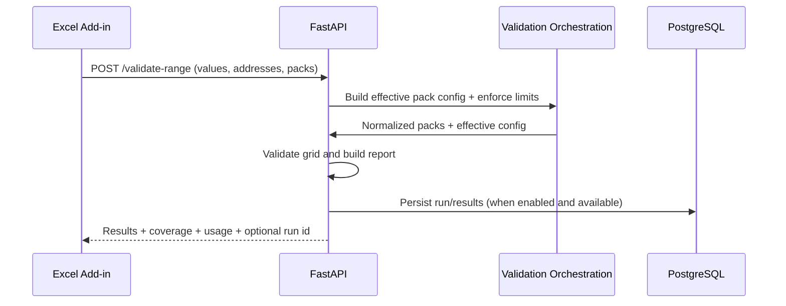
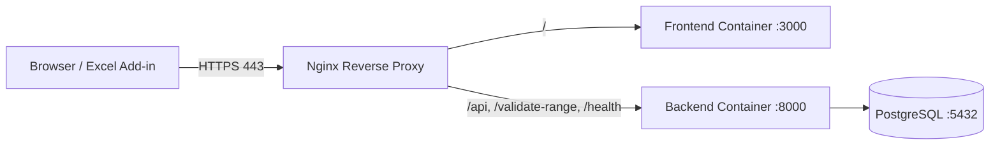

# Architecture

## System overview

Bordereaux Validation is a split frontend/backend system for validating Excel bordereaux ranges with configurable test packs. The frontend (Office add-in assets) calls backend APIs for validation, configuration, subscriptions, result persistence, and exception workflows.

- Frontend ([frontend](../frontend)): UI actions, range extraction, workflow orchestration, and rendering results.
- API layer ([backend/app/api](../backend/app/api)): endpoint routing, request/response contracts, and auth-bound request handling.
- Service layer ([backend/app/services](../backend/app/services)): orchestration for validation, results versioning, exceptions, subscription logic, and configuration.
- Repository/data layer ([backend/app/repositories](../backend/app/repositories)): persistence and data access boundaries.
- Validation/test pack layer ([backend/app/validation.py](../backend/app/validation.py), [backend/app/testpacks](../backend/app/testpacks)): rule evaluation and pack-specific requirements.

## Data flow

Additional flows:
- Configuration endpoints provide template generation, territory lookup, and field mapping estimation.
- Results endpoints manage version history, latest version retrieval, updates, deletion, and cross-version comparisons.
- Exceptions endpoints manage exception records and tag propagation/removal across stored artifacts.

## External dependencies

- Backend runtime: FastAPI, Uvicorn, SQLAlchemy async stack, PostgreSQL driver, python-dotenv.
- Backend quality gates: Ruff + pytest via [scripts/ci.sh](../scripts/ci.sh).
- Frontend runtime/tooling: Node.js, Office add-in tooling, http-server, ESLint, Node test runner.
- Platform services: PostgreSQL database; optional Nginx TLS reverse proxy in containerized setup.

## Deployment architecture

- Container orchestration is defined in [docker-compose.yml](../docker-compose.yml).
- Backend and frontend each have dedicated Dockerfiles in [backend/Dockerfile](../backend/Dockerfile) and [frontend/Dockerfile](../frontend/Dockerfile).
- Nginx routing and TLS termination are defined in [nginx/nginx.conf](../nginx/nginx.conf).
- Local development can also run directly without containers using [scripts/start-all.sh](../scripts/start-all.sh).